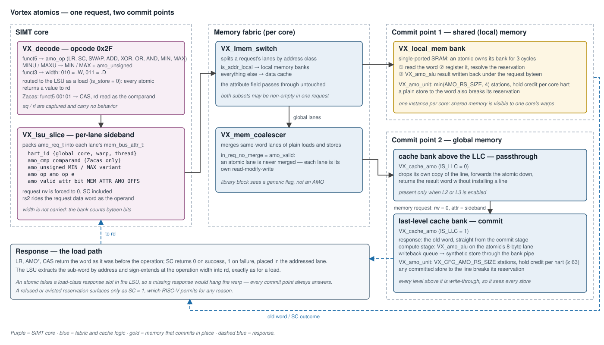
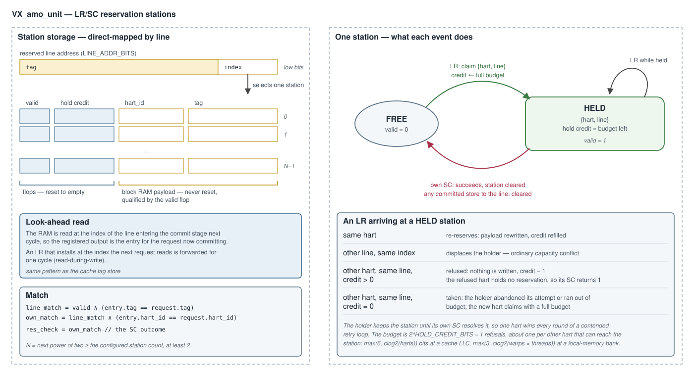
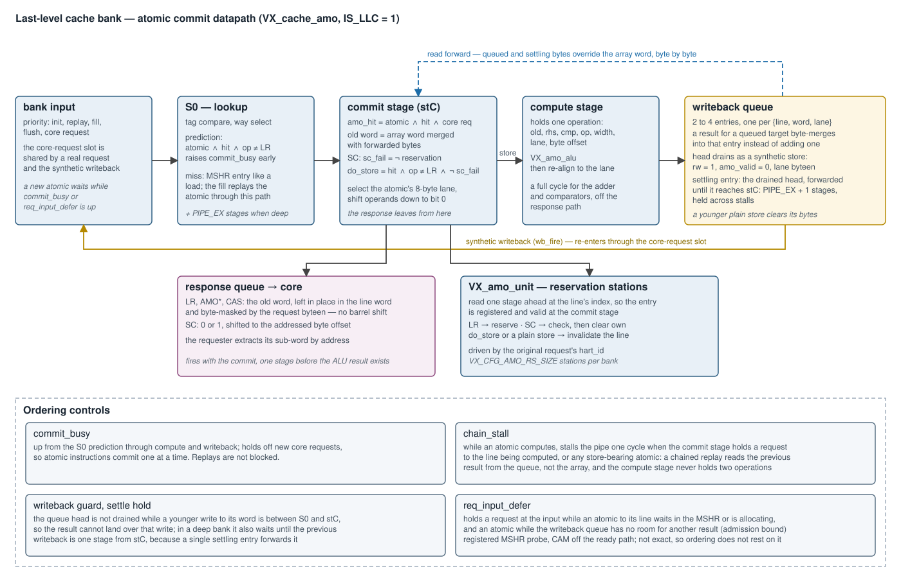

# Atomic Memory Operations (RVA) — Design

**Scope:** the Vortex implementation of the RISC-V "A" extension — `LR`/`SC`,
the nine `AMO*` read-modify-write operations in `.W` and `.D` widths, and the
Zacas compare-and-swap (`AMOCAS`). Covers instruction decode, the per-lane
sideband the LSU attaches, the two places an atomic commits (the last-level
cache bank and the local-memory bank), the reservation stations, and the
SimX model. RTL: [`VX_amo_alu.sv`](../../hw/rtl/cache/VX_amo_alu.sv),
[`VX_amo_unit.sv`](../../hw/rtl/cache/VX_amo_unit.sv),
[`VX_cache_amo.sv`](../../hw/rtl/cache/VX_cache_amo.sv),
[`VX_local_mem.sv`](../../hw/rtl/mem/VX_local_mem.sv). SimX:
[`sim/simx/amo/`](../../sim/simx/amo/),
[`sim/simx/mem/cache.cpp`](../../sim/simx/mem/cache.cpp),
[`sim/simx/mem/local_mem.cpp`](../../sim/simx/mem/local_mem.cpp).

How atomics behave across a multi-level cache hierarchy — the passthrough
role of a cache above the last level, issuer self-consistency, and the
coherence model — is in
[`multicache_amo_coherence.md`](multicache_amo_coherence.md). The cache bank
the engine plugs into is in [`cache_subsystem.md`](cache_subsystem.md). This
document is the atomics deep-dive.



---

## 1. Overview

An atomic is a **load that also writes**. It travels the load path end to
end — a load-class LSU slot, a request with `rw = 0`, a response carrying a
value for `rd` — and the read-modify-write happens at the one place that
owns the word:

1. **Decode** classifies opcode `0x2F`, maps `funct5` to an operation, and
   routes the instruction to the LSU as a load.
2. The **LSU** attaches a per-lane sideband (`amo_req_t`) naming the
   operation and the issuing hart, and forces the request's `rw` to 0.
3. The **memory fabric** steers each lane by address class and never merges
   an atomic lane with another.
4. The lane **commits** at one of two points: the **local-memory bank** for a
   shared-memory address, or the **last-level cache (LLC) bank** for a global
   address. Both use the same ALU and the same reservation unit.
5. The **response** returns the word as it was before the operation (or the
   `SC` outcome) and the LSU writes it to `rd`.

The defining choice is that **global atomics resolve at the LLC**. The device
must build exactly one LLC instance, so every hart's atomics on a word meet at
one point, and every cache level above it must be write-through, so the LLC
observes every store to a line and can keep `LR`/`SC` reservations honest
(§9).

---

## 2. Instruction decode

[`VX_decode.sv`](../../hw/rtl/core/VX_decode.sv),
[`sim/simx/decode.cpp`](../../sim/simx/decode.cpp). Opcode `0x2F` is
`INST_AMO`.

| field | meaning |
|---|---|
| `funct3` | width — `010` = `.W` (32-bit), `011` = `.D` (64-bit) |
| `funct5` | operation (table below) |
| `aq`, `rl` | captured, carry no behavior. An atomic is ordered against the other accesses to its own word (§6.5); the order against the hart's accesses to *other* addresses that the bits ask for is not enforced, by the LSU or by the cache — a `fence` gives it ([LSU design §3.3](lsu_pipeline_design.md#33-fence-ordering)) |
| `rs1` | address (no immediate offset) |
| `rs2` | operand; not read by `LR` |
| `rd` | destination; for `AMOCAS` also the comparand |

| `funct5` | instruction | `amo_op_e` | `amo_unsigned` |
|---|---|---|---|
| `00010` | `LR` | `AMO_OP_LR` = 0 | 0 |
| `00011` | `SC` | `AMO_OP_SC` = 1 | 0 |
| `00000` | `AMOADD` | `AMO_OP_ADD` = 2 | 0 |
| `00001` | `AMOSWAP` | `AMO_OP_SWAP` = 3 | 0 |
| `00100` | `AMOXOR` | `AMO_OP_XOR` = 4 | 0 |
| `01000` | `AMOOR` | `AMO_OP_OR` = 5 | 0 |
| `01100` | `AMOAND` | `AMO_OP_AND` = 6 | 0 |
| `10000` / `11000` | `AMOMIN` / `AMOMINU` | `AMO_OP_MIN` = 7 | 0 / 1 |
| `10100` / `11100` | `AMOMAX` / `AMOMAXU` | `AMO_OP_MAX` = 8 | 0 / 1 |
| `00101` | `AMOCAS` (Zacas) | `AMO_OP_CAS` = 9 | 0 |

The unsigned min/max variants collapse onto the signed opcodes plus one bit,
so the operation field stays four bits wide.

**Compare-and-swap reads `rd`.** `AMOCAS` compares memory against `rd`, stores
`rs2` on a match, and writes the old value back to `rd`. The decoder routes
`rd` into the third operand slot — for an atomic that slot's register field
is the `funct5` bits and is otherwise unused — so the comparand reaches the
LSU as `rs3_data` with no new operand path.

---

## 3. The LSU sideband

[`VX_lsu_slice.sv`](../../hw/rtl/core/VX_lsu_slice.sv) packs one `amo_req_t`
per lane into the lane's memory attribute
([`VX_gpu_pkg.sv`](../../hw/rtl/VX_gpu_pkg.sv)):

| field | width | meaning |
|---|---|---|
| `hart_id` | `clog2(NUM_TOTAL_CORES) + NW_BITS + NT_BITS`, `NUM_TOTAL_CORES` = the instantiated cores | `{global core, warp, thread}` — the reservation owner |
| `amo_cmp` | `XLEN` | compare-and-swap comparand; present only with Zacas |
| `amo_unsigned` | 1 | unsigned `MIN`/`MAX` |
| `amo_op` | 4 | `amo_op_e` |
| `amo_valid` | 1 | the lane is an atomic; sits at `MEM_ATTR_AMO_OFFS` |

Load-bearing properties:

- **`rw` is forced to 0 for every atomic, `SC` included.** A store that misses
  allocates and writes; a store-conditional that misses must instead fetch
  the line and then decide. Riding the load path gives that ordering for
  free, and gives every atomic the response slot it needs to reach `rd`.
- **Width is not carried.** The commit point derives it from the request's
  byte-enable popcount — four bytes is `.W`, eight is `.D`.
- **The thread field is the warp thread, not the lane.** With fewer LSU lanes
  than threads, a warp's request leaves in packets, and lane `i` of packet
  `pid` carries thread `pid * NUM_LANES + i` — the id SimX's `make_hart_id`
  uses. A lane index would give threads a packet apart one owner, and either
  could store-conditional on the other's reservation.
- **The core field is the global core id, not the core's index in its
  cluster.** An L3 last-level cache holds reservations from every cluster,
  and SimX's `make_hart_id` takes the global id too. A per-cluster index would
  give core `c` of every cluster one owner, and either could store-conditional
  on the other's reservation. The field counts the instantiated cores,
  `NUM_CLUSTERS × NUM_SOCKETS × SOCKET_SIZE`, not `NUM_CLUSTERS × NUM_CORES`:
  with `SOCKET_SIZE > NUM_CORES` every cluster still builds a full socket. A
  `STATIC_ASSERT` in `VX_lsu_slice` checks that its core id fits the field.
- **The operand rides the data word**, lane-positioned exactly like a plain
  store's data. Compare-and-swap needs a third value and the data word is
  already taken by the swap value, which is why the comparand travels in the
  sideband — and why Zacas is off by default: it widens every memory request
  by `XLEN` bits.
- **The sideband is opaque to the fabric.** The attribute field is cast by
  offset at the commit point, so the shared library blocks under
  `hw/rtl/libs/` contain no atomic logic. The coalescer is told only
  `in_req_no_merge` ([`VX_mem_unit.sv`](../../hw/rtl/core/VX_mem_unit.sv)):
  an atomic lane is never merged, because two read-modify-writes to one word
  are two operations, not one.

A virtual-memory build checks an atomic's permissions as a **write**: the
request arrives with `rw = 0`, so the MMU takes the write intent from the
`amo` bit, and a fault records it
([`virtual_memory_subsystem.md`](virtual_memory_subsystem.md)).

---

## 4. The RMW kernel — `VX_amo_alu`

[`VX_amo_alu.sv`](../../hw/rtl/cache/VX_amo_alu.sv) is pure combinational
logic shared by both commit points.

| port | direction | meaning |
|---|---|---|
| `op`, `is_unsigned`, `width` | in | operation, min/max variant, `.W` (2) or `.D` (3) |
| `old_word` | in | the word currently in memory, right-aligned |
| `rhs` | in | the operand (`rs2`) |
| `cmp` | in | the compare-and-swap comparand |
| `new_word` | out | the value to write |
| `ret_word` | out | the old value, zero-extended |

| operation | `new_word` |
|---|---|
| `LR` | old (nothing is stored) |
| `SC`, `SWAP` | `rhs` |
| `ADD`, `AND`, `OR`, `XOR` | old *op* `rhs` |
| `MIN`, `MAX` | signed or unsigned compare, selected by `is_unsigned` |
| `CAS` | `rhs` if old equals `cmp`, else old |

A `.W` operation on a 64-bit datapath masks both operands to 32 bits and
sign-extends at bit 31 for the signed comparisons.

Two parameters keep the datapath no wider than the build needs:

- `DATA_WIDTH` — the operand width, the cache word capped at 64. A 32-bit
  word can only carry `.W`, so the adder and comparators are built 32-bit.
- `ARITH_WIDTH` — the width of every operation **except** compare-and-swap.
  A 32-bit hart issues 64-bit operands only for the Zacas pair, so its adder
  and comparators shrink to 32 bits while the equality compare stays full
  width. The bank asserts that no `.D` arithmetic atomic reaches a narrowed
  build.

**A failed compare-and-swap still stores.** On a mismatch the old value is
written back unchanged rather than the store being suppressed. The commit
therefore still breaks other harts' reservations on the word — which the
specification requires — and the operation needs no special case downstream.

---

## 5. Reservations — `VX_amo_unit`

[`VX_amo_unit.sv`](../../hw/rtl/cache/VX_amo_unit.sv) holds the ALU and a
bounded set of reservation stations.



### 5.1 Storage

The stations are **direct-mapped on the reserved line's low address bits**.
Each holds `{valid, hold credit, hart_id, tag}`: the valid bit and the credit
in resettable flops, the `{hart_id, tag}` payload in a block RAM read one
stage ahead so the registered entry is present the cycle the commit decision
is made. Capacity is the next power of two at or above the configured count.

A bounded set, rather than one slot per hart, is what keeps the storage
independent of the hart count — a 128-hart configuration would otherwise
carry 128 line addresses and a 128-way compare **per bank**.

### 5.2 Events

| event | source | effect |
|---|---|---|
| `res_reserve` | an `LR` commits | claim the station for `{hart, line}` unless refused (§5.3) |
| `res_clear` | an `SC` commits, pass or fail | clear the station if this hart holds it |
| `res_invalidate` | any store commits to the line; in local memory, also a DMA write | clear the station if it holds that line, whichever hart reserved it |
| `res_check` | combinational | `SC` succeeds iff the station holds `{this hart, this line}` |

### 5.3 The holder is protected

Every hart contending one word maps to the same station. If each `LR`
overwrote it, no `SC` would ever find its own reservation and a contended
retry loop would make no progress. So a live reservation is **not handed to
another hart on demand**: an `LR` from a different hart for the same line is
refused — it reserves nothing, and its `SC` fails.

The protection is bounded. A retry loop is free to abandon an attempt, and a
holder that never issues its `SC` would otherwise own the station forever.
Each refused `LR` spends one **hold credit**; when the credit reaches zero the
next foreign `LR` takes the station.

The budget must outlast the foreign `LR`s that arrive between the holder's
`LR` and its `SC`. In a constrained `LR`/`SC` loop a hart has at most one `LR`
or `SC` in flight: the `SC` waits on the `LR`'s value, and the next `LR` waits
on the `SC`'s outcome. A hart refused during a hold must finish its failing
`SC` before it can `LR` again, while the holder's `SC` follows its own `LR` by
one round trip. With `H` harts that can reach the bank,
`HOLD_CREDIT_BITS >= clog2(H)` gives `2^HOLD_CREDIT_BITS - 1 >= H - 1`: one
refused `LR` from every other hart. That sizing is empirical: it held in
every configuration measured, single-issue cores and, in local memory, two
LSU blocks per bank (`lmem-2blocks`, §10). The local-memory bank grants its
LSU inputs round-robin
([LSU design §5.2](lsu_pipeline_design.md#52-local-path)), so no LSU block
can lock the holder's `SC` out of the bank. What stays unproven is the order
the bound assumes: that the holder's `SC` reaches the bank before any refused
hart has finished its failing `SC` and sent a second `LR`. Nothing ahead of
the bank enforces it: neither the warp scheduler nor the LSU queues keep the
holder's one round trip shorter than a refused hart's two, and a hart refused
twice inside one hold spends the budget early.

| deployment | stations | `HOLD_CREDIT_BITS` | harts `H` that reach the bank | default budget |
|---|---|---|---|---|
| cache LLC bank | `VX_CFG_AMO_RS_SIZE` | `max(6, clog2(H))` | every hart in the device: instantiated cores × warps × threads | 63 refusals |
| local-memory bank | `min(VX_CFG_AMO_RS_SIZE, 4)` | `max(3, clog2(H))` | the owning core's warps × threads | 15 refusals (4 warps × 4 threads) |

A budget below `H - 1` lets the holder be displaced before its `SC` lands,
and contended loops can starve. Every thread has its own hart id, so when an
8-thread warp is split into LSU packets the holder's 7 warp siblings alone
spend a 7-refusal budget.

A cache bank does not know whether it is a socket's L1, a cluster's L2 or
the L3, so the LLC sizes for the whole device. That count is exact: the A
extension requires one LLC instance that every hart reaches (§9). The
floors set the minimum for small configurations: 63 refusals in the LLC,
where an `LR`→`SC` spans an L1-miss round trip, and 7 in local memory. The
budget stays finite on purpose. Its lapse is what frees a station whose
holder abandoned its attempt, or whose `SC` is held back behind other
requests to the bank. A larger budget makes that slower: a lone contender
needs `2^HOLD_CREDIT_BITS - 1` refused rounds to reclaim a station whose
holder abandoned its attempt.

### 5.4 Why this is legal

RISC-V allows `SC` to fail for any reason, so capacity eviction, an index
conflict between two lines, and a refused `LR` are all conforming. What the
specification forbids is a spurious **success**, and every path that can
write the line — an atomic's store, a plain store arriving write-through
from above, the LLC's own write hit, a DMA write into local memory — drives
`res_invalidate`. Forward progress is the system property the hold credit
exists to preserve: one hart wins each round.

---

## 6. Commit at the last-level cache

[`VX_cache_amo.sv`](../../hw/rtl/cache/VX_cache_amo.sv) is instantiated by
every cache bank when atomics are enabled. With `IS_LLC = 1` it commits; with
`IS_LLC = 0` it forwards
([`multicache_amo_coherence.md`](multicache_amo_coherence.md)). The two roles
are exclusive, so each ties off the other's outputs and only the selected
datapath is synthesized.



### 6.1 The commit stage

An atomic that hits reaches the commit stage with the line word read. There:

```
amo_hit  = atomic ∧ hit ∧ core request
sc_fail  = (op == SC) ∧ ¬res_check
do_store = amo_hit ∧ (op ≠ LR) ∧ ¬sc_fail
```

The **response fires from this stage**, before any arithmetic. It is the old
word, left where it sits in the line word and masked by the request's
byte-enable; an `SC` outcome is a single bit shifted to the addressed byte
offset. The requester extracts its sub-word by address, so no full-width
shift round trip sits on the read-to-response path.

A miss takes an MSHR entry like a load. The fill replays the atomic through
the same stage, so miss and hit commit identically. So does an atomic that
hits a line whose chain still holds an older entry for its word: the bank
demotes it onto that chain like any other request
([`cache_subsystem.md`](cache_subsystem.md) §4.5), and it commits at its
replay.

### 6.2 The lane datapath

An atomic touches at most eight naturally aligned bytes. A wide-word LLC —
one whose word is an L1 line — would otherwise pay for full-word shifters,
queues and compares that only ever carry one such **lane**. The engine
selects the lane first and runs everything downstream at lane width; each
full-width output is rebuilt by replicating the lane under a lane-positioned
byte-enable. Natural alignment is asserted: an atomic's byte-enable may not
cross its lane.

### 6.3 Compute stage and writeback queue

| stage | holds | does |
|---|---|---|
| compute | one operation: aligned `old`, `rhs`, `cmp`, op, width, lane, offset | `VX_amo_alu`, then re-align to the lane — a full cycle, off the response path |
| writeback queue | 2–4 entries, one per `{line, word, lane}` | queues the result; a result for a target already queued byte-merges into that entry |
| settling entry | the drained head, until the writeback reaches the commit stage ([`PIPE_EX`](cache_subsystem.md#41-the-bank-pipeline) + 1 stages, held across stalls) | covers the window until the array write lands |

The queue head drains as a **synthetic store** through the bank's
core-request slot: `rw = 1`, `amo_valid = 0`, the lane's byte-enable. It
takes the ordinary write path, so on a write-through LLC it also goes to
memory, and on a write-back LLC it dirties the line.

The queue is bounded at admission, not by its sizing. The head drains only
through a free input slot, and replays and fills take that slot first, so a
run of fills that each replay an atomic queues one result after another with
no drain in between. An atomic is therefore admitted only while fewer than
the queue depth of store-bearing atomics are in the bank and not yet
committed, those waiting in the MSHR included (`req_input_defer`, §6.5). A
core request enters only with the queue and the compute stage empty, so the
results queued, computing and still to come never exceed the queue. Holding
the pipe on a full queue instead would deadlock: the drain needs an unstalled
input slot. The bound and the overflow are both asserted. The cost is that a
bank has at most a queue's worth of store-bearing atomics outstanding,
however large its MSHR.

### 6.4 Read forwarding

A request that reads an atomic's bytes while the result is still queued or
settling must observe them. The forward network yields, per byte, the queued
writer, else the settling entry, else the array. The queue keeps at most one
entry per `{line, word, lane}` and a queued write drops its bytes from the
settling entry, so every byte has **at most one writer** and the merge is a
plain OR-tree rather than a newest-wins priority scan.

The same network supplies the next atomic's old operand. And it works in the
other direction: a younger plain store to queued or settling bytes
supersedes them, clearing those bytes so neither the writeback nor the
forward resurrects a stale value. A head that drains in the cycle the store
commits leaves with those bytes already cleared, and a head is not drained at
all while a younger store to its word is still between lookup and commit
(§6.5), so a queued result never lands over the store that superseded it.

Only a replayed store supersedes anything. A core request is admitted while
the engine is idle, so a store on its first pass finds nothing queued or
settling — including a store the bank demotes onto a chain
([`cache_subsystem.md`](cache_subsystem.md) §4.5), whose array write waits
for its replay while older chained requests still read the word. The bank
asserts that case.

### 6.5 Ordering controls

| signal | condition | effect |
|---|---|---|
| `commit_busy` | from the lookup-stage prediction through compute and writeback | new core requests wait — atomic instructions commit one at a time |
| `chain_stall` | an atomic is computing and the commit stage holds a request to the same line, or any store-bearing atomic | the pipe stalls one cycle, so a chained replay reads the previous result and the compute stage never holds two operations |
| writeback guard | a younger write to the queue head's word is between lookup and commit | the head is not drained, so the result cannot land over that write |
| settle hold | in a deep bank, the previous writeback is more than one stage from commit | the head is not drained: a single settling entry forwards the writeback in flight until it reaches the commit stage |
| `req_input_defer` | an atomic to the incoming request's line waits in the MSHR or is allocating; or the request is an atomic and the writeback queue has no room for another result (§6.3) | the request waits at the input |

`commit_busy` does not block replays: the MSHR streams same-line atomics that
coalesced on a miss back to back, and `chain_stall` paces those instead. It
also holds a replayed store-bearing atomic of any other line, which reaches
the commit stage without passing `commit_busy` and would otherwise overwrite
the operation still in the compute stage. A failing `SC` is held with them —
its outcome is not known in time — and loses a cycle. In a deep bank the
lookup and commit stages are several cycles apart, so the lookup-stage
prediction is carried across the gap to keep `commit_busy` continuous.

`req_input_defer` keeps a request from queueing up behind a pending atomic on
its line. It consumes a **registered** MSHR probe, which keeps the MSHR's
address compare off the request-ready path, and it is not exact. A result
registered for one request is applied to the next when the bank's input
changes without firing — an unbuffered request crossbar switching ports — and
an entry is visible to none of the guard's terms in the cycle it is
finalized. So a request can enter while an atomic to its line is pending.

**Ordering does not depend on the guard.** A request that slips past it joins
the line's MSHR chain, and the bank's per-word order
([`cache_subsystem.md`](cache_subsystem.md) §4.5) applies to atomics as to
every other request: a store-bearing atomic counts as a store, whether it is
the chained entry or the incoming hit, so nothing to its word completes
around it. A younger store chained behind it supersedes its queued bytes
(§6.4), and the writeback guard keeps the queued result from landing over
that store.

---

## 7. Commit at the local-memory bank

Shared (local) memory is a per-core SRAM, not a cache, so there is no line
to fetch and no level below: [`VX_local_mem.sv`](../../hw/rtl/mem/VX_local_mem.sv)
commits in place. [`VX_lmem_switch.sv`](../../hw/rtl/mem/VX_lmem_switch.sv)
passes the attribute through unchanged on the local path.

The bank is single-ported, so an atomic owns it for three cycles:

| cycle | bank | reservation |
|---|---|---|
| 1 — read | the request reads the word; this read is also the response | the station is read, look-ahead |
| 2 — capture | the word is registered | `LR` reserves, `SC` checks and clears, a store invalidates |
| 3 — write back | the ALU result is written under the request's byte-enable | — |

A DMA beat — a DXA tile write or a tensor-core WGMMA operand read — that
touches a bank whose atomic has not yet written back waits rather than split
the read-modify-write, and while it waits it holds LSU acceptance off the
banks it touches, so the wait is bounded by the capture and write-back cycles.
SimX holds a DXA beat only behind an atomic on the bank its block address
maps to, where the RTL waits on every bank the beat touches. SimX applies an
atomic's read-modify-write in one step, so no beat can split it there either;
the difference is timing only.

The word is registered **before** the ALU sees it. Feeding the ALU from the
SRAM output would put the memory's clock-to-out, the adder, and the memory's
setup in one period; the register splits that in two.

On a 64-bit hart the bank word holds two 32-bit lanes. A `.W` atomic to the
upper lane shifts its operands down, computes right-aligned, and shifts the
result back; the `SC` outcome is likewise placed in the addressed lane,
because the LSU extracts by address and an outcome left at bit 0 would read
as success for every upper-lane `SC`.

A plain store reaches the reservation stage the same way an atomic does, one
cycle after acceptance, so a plain store to a reserved word breaks the
reservation.

A DMA write breaks reservations too. RISC-V requires an `SC` to fail when
another device writes the reserved bytes between the `LR` and the `SC`, and a
DXA tile write is such a write. The beat takes the reservation stage the
cycle after it writes the bank — no LSU request can hold that cycle, since
none is accepted beside a DMA beat — and clears the reservation on every bank
word it wrote, whichever hart holds it. It adds no cycle, and a DMA read
leaves reservations alone. Because a beat never lands inside an atomic's
three cycles, it cannot fall between an `SC`'s check and its write-back. SimX
does the same: a DXA write carries the `dma` request flag, and the bank
breaks every hart's reservation on each bank word the write touches.

---

## 8. SimX model

| aspect | RTL | SimX |
|---|---|---|
| RMW kernel | `VX_amo_alu` | `amo_compute()` in [`amo_ops.h`](../../sim/simx/amo/amo_ops.h) |
| operation encoding | `amo_op_e`, 0–9 | `MemOp::AMO_LR`…`AMO_CAS`, 3–12, inside the unified memory-op enum |
| request direction | `rw = 0` | `is_write()` is **true** for an atomic |
| LLC commit | `VX_cache_amo`, commit role | `CacheBank::commitAmo()` |
| atomics outstanding per LLC bank | at most the writeback queue's depth of store-bearing ones (§6.3) | bounded by the MSHR only: the read-modify-write is one step, with no queue |
| above the LLC | `VX_cache_amo`, passthrough role | `AmoProbe` request type |
| local memory | 3-cycle in-place RMW | same occupancy, modeled as a per-bank busy count |
| reservations | bounded line-indexed stations with hold credit | one reservation **per hart** |

Two of these differences matter when mirroring logic between the models:

- **Request direction.** A SimX predicate written to mirror an RTL condition
  gated on `~rw` must admit atomics explicitly —
  `!is_write() || memop_is_atomic(op)` — or it silently excludes exactly the
  requests it was written for.
- **Reservation policy.** [`AmoUnit`](../../sim/simx/amo/amo_unit.h) keeps a
  `hart → line` map: a hart's reservation is never displaced by another
  hart's `LR`. Both policies are RISC-V-legal and both produce correct final
  results, but they fail spuriously at different rates, so a contended retry
  loop runs a different number of iterations in each model. **An application
  that uses `LR`/`SC` cannot host a `model_parity` case**, which requires an
  exact retired-instruction match. The read-modify-write atomics and
  compare-and-swap have no retry loop and are unaffected.

---

## 9. Configuration

[`VX_config.toml`](../../VX_config.toml):

| knob | default | meaning |
|---|---|---|
| `VX_CFG_EXT_A_ENABLE` | false | the A extension; sets `MISA` bit 0 |
| `VX_CFG_EXT_ZACAS_ENABLE` | false | compare-and-swap; requires A, widens every memory request by `XLEN` |
| `VX_CFG_AMO_RS_SIZE` | `max(NUM_WARPS, NUM_CORES × NUM_WARPS / L2_NUM_BANKS)` | reservation stations per LLC bank |

`AMO_ENABLE` is a **parameter** on the cache and local-memory modules, driven
by `VX_CFG_EXT_A_ENABLED`, not a preprocessor gate. The operation enum and
the sideband are defined unconditionally so that the parameter can do the
gating; with the extension off, the sideband bits are still allocated in the
attribute field and the engine is generated away.

**Every cache level above the LLC must be write-through.** A write-back
intermediate could absorb a store without the LLC seeing it, and a later `SC`
to that line would then succeed when it must not. The requirement is a build
failure, not a convention:

| hierarchy | LLC | asserted |
|---|---|---|
| L1 only | L1 | nothing — the LLC itself may be write-back |
| L1 + L2 | L2 | `DCACHE_WRITEBACK == 0` |
| L1 + L2 + L3 | L3 | `DCACHE_WRITEBACK == 0`, `L2_WRITEBACK == 0` |

Enforced in [`Vortex.sv`](../../hw/rtl/Vortex.sv) and
[`processor.cpp`](../../sim/simx/processor.cpp). The default write-back
expressions already satisfy it, since each level is write-back only when it
is the LLC.

**The device must build exactly one LLC instance.** An atomic must be atomic
with respect to every hart in the device, and nothing keeps two LLC instances
coherent: each executes the atomics and holds the reservations for its own
copy of a line. Harts behind different instances would update one word at two
points, so an `AMOADD` from each loses an update and an `SC` succeeds against
a store the other instance absorbed. The instances are counted as the RTL and
SimX build them:

| enabled | LLC | instances | allowed with A |
|---|---|---|---|
| L3 | the L3 | 1 | always |
| L2, no L3 | each cluster's L2 | `NUM_CLUSTERS` | one cluster |
| neither | each socket's dcaches | `NUM_CLUSTERS × NUM_SOCKETS × NUM_DCACHES` | one dcache in the device |

with `NUM_SOCKETS = max(1, floor(NUM_CORES / SOCKET_SIZE))` and
`NUM_DCACHES = max(1, floor(SOCKET_SIZE / 4))`, or 0 with the dcache disabled.
So a build with the A extension is rejected when it has:

- two or more clusters with an L2 and no L3 (one LLC per cluster);
- no L2 or L3 and more than one dcache in the device — `--cores=N` with the
  default `SOCKET_SIZE=1` (one socket, and one dcache, per core), more than
  one cluster, or one socket of 8 or more cores (two or more dcaches);
- no cache at all: the dcache disabled with no L2 or L3, where nothing
  executes a global atomic.

The fix is to enable the L2 for one cluster or the L3 for several. The check
is a `STATIC_ASSERT` in [`Vortex.sv`](../../hw/rtl/Vortex.sv), so rtlsim and
xrtsim stop at time 0 with the message, and a `static_assert` in
[`processor.cpp`](../../sim/simx/processor.cpp), so SimX does not compile.
Synthesis does not check it: `STATIC_ASSERT` is empty under `SYNTHESIS`. It
applies to every build that enables A, including applications that force the
extension on, such as those built through
[`tests/vulkan/common.mk`](../../tests/vulkan/common.mk).

---

## 10. Verification

`tests/regression/amo` runs each case across every hart of the launch:

| # | case | checks |
|---|---|---|
| 0–5 | `amoadd`, `amoor`, `amoand`, `amoxor`, `amomax`, `amominu` | the final word after every hart hammers one address |
| 6 | `amoswap` | the final word and every observed old value is the initial sentinel or a valid hart id |
| 7 | `lrsc_counter` | a lock-free `LR`/`SC` increment loop; the forward-progress case |
| 8, 9 | `amoadd_aqrl`, `lrsc_counter_aqrl` | the `aq`/`rl` encodings decode and behave identically |
| 10 | `atomic_reduction` | an `atomicAdd` reduction |
| 11 | `atomic_critical` | a spinlock around a plain load/store critical section, one thread per warp |
| 12 | `self_consistency` | a hart reads back its own atomic through a plain load |
| 13, 14 | `amoadd_lmem`, `lrsc_lmem` | cases 0 and 7 on local memory |
| 15, 16 | `cas_ladder`, `cas_lmem` | every hart races compare-and-swap for each slot; compiled only with Zacas |
| 15, 16 (17, 18 with Zacas) | `lrsc_foreign`, `lrsc_foreign_lmem` | one warp: an `SC` into another thread's reservation fails and leaves it for the owner's `SC`, which succeeds unless the warp has more threads than the stations can keep apart; the two threads share an LSU lane when the warp splits into packets |
| 17 (19 with Zacas) | `lrsc_peer` | a peer hart's `SC` into a word that core 0 holds fails, writes nothing and leaves the reservation live, so the holder's `SC` succeeds; once the holder reserves the word again, the peer's swap fails the holder's next `SC`, and the peer's own `LR`/`SC` on another line succeeds; the peer is the first core of the last cluster, core 1 with one cluster, and warp 1 with one core |

The `LR`/`SC` increment loops (7, 9, 14) give up after a fixed number of
retries per increment, so a loop that starves comes up short and fails
instead of hanging the run.

The `amo` category in [`ci/testcases/amo.yaml`](../../ci/testcases/amo.yaml)
runs them on both simulators at both `XLEN`s, with and without Zacas, with
fewer LSU lanes than threads and with a narrower SIMD width, on a write-back
LLC, at 8 threads, and across the 4-core L2 and L2+L3 hierarchies, alongside
the `rv32ua` / `rv64ua` ISA conformance tests. With 8-thread warps split
into LSU packets of 2, two cases pin the local-memory budget to its sizing —
the contended `LR`/`SC` loops at 4 warps (`threads8-lanes2`, RV32 only) and
at 8 warps (`warps8-threads8-lanes2`) — and `mc-l2-w8t8-lanes2` runs the
global loops with 256 harts behind one L2 (4 cores of 8 warps), where the LLC
budget rises above its floor. A 63-refusal LLC budget there slowed the loops
about fourfold without stopping them, so that case covers progress at this
scale rather than pinning the LLC sizing.

Two clusters of two cores behind an L3, with L2s (`mc-xcluster-l3`) and
without (`mc-xcluster-l3-nol2`), run the global `LR`/`SC` loops and
`lrsc_peer` where the L3 holds reservations from both clusters. There the
peer differs from core 0 only in the cluster part of its core id.

The order of an atomic against the other accesses to its word (§6.4, §6.5)
is checked at two levels. The cache testbench
([`hw/unittest/cache`](../../hw/unittest/cache),
`make -C hw/unittest run-cache`) drives a last-level bank directly and
releases a held fill at every cycle offset around a race: an atomic on a
resident line against a replayed one on another line, a store or a load
chained behind an atomic (also with memory refusing requests while the chain
replays), atomics on several missing lines whose fills return together, and
a request that reaches the filled line while an older access to its word
still waits in the chain.
[`tests/regression/cache_order`](../../tests/regression/cache_order) runs the
patterns from software — a hart's `amoadd` or `LR` after its own store, its
load after its own `amoadd`, an `amoadd` racing another warp's store, and
every hart's atomics on cold and resident lines of one bank — as
`amo:cache-order` (one core, write-back dcache, every pattern),
`amo:cache-order-l2` (four cores under a write-back L2: the patterns that
race different harts, since each L1 holds a hart's atomic behind its own
older accesses, up to the open input-guard windows in
[`multicache_amo_coherence.md`](multicache_amo_coherence.md) §10) and
`amo:cache-order-shared` (four cores on one
write-through dcache, where an atomic and a younger store to its word must
also reach memory in order).

The one-LLC rule (§9) has no CI case, because the catalog cannot express a
build that must fail; check it by hand:
`CONFIGS=-DVX_CFG_EXT_A_ENABLE ./ci/blackbox.sh --driver=simx --app=amo --cores=2`
must fail to build with the §9 message, and `--driver=rtlsim` must stop at
time 0.

[`tests/regression/lmem_amo_dma`](../../tests/regression/lmem_amo_dma) races
DXA copies against local-memory atomics: one warp streams tile copies into
local memory while the others hammer atomics on words that share every bank,
and the run fails if no atomic completed while the copies were in flight. It
runs as `amo:lmem-dma` on both simulators and as the `amo:parity-lmem-dma`
cycle-parity case. The `VX_local_mem` unit testbench
([`hw/unittest/local_mem`](../../hw/unittest/local_mem),
`make -C hw/unittest run-lmem`) injects a DMA access at every cycle offset
around an atomic and across an `LR`/`SC` window, then runs a randomized
golden-model stress, with A and with A + Zacas; a build with atomics off runs
the load/store/DMA stress alone. In the window, a DMA write to a reserved
byte between the `LR` and the `SC` must fail the `SC`; a write to another
word, a DMA read, a write before the `LR` or after the `SC`, and a word
reserved again after the write must not.

[`tests/regression/lmem_lrsc_dma`](../../tests/regression/lmem_lrsc_dma)
checks the same rule end to end: lanes of one warp reserve local-memory words,
the warp copies a tile over some of them with the DXA, and each lane then
tries its `SC`. It must fail on a word the copy wrote — on RV64 also an
`lr.d` word the copy wrote only the upper half of — and succeed on a word
outside the copy, on a word in a bank the copy's partial last row skips (when
the bank count leaves it one), and after a fresh `LR`. It runs as
`amo:lrsc-dma` on both simulators.

At 32 warps a core issues two-wide, so two LSU blocks share every
local-memory bank, which must grant them fairly
([LSU design §5.2](lsu_pipeline_design.md#52-local-path)). `amo:lmem-2blocks`
runs the local-memory `LR`/`SC` loop in that shape, where neither block's
retries may lock the other out of the counter's bank.
[`tests/regression/lmem_fairness`](../../tests/regression/lmem_fairness)
tests the grant directly: the warps of LSU block 0 poll a local-memory flag
with atomics, keeping its bank busy, while one warp of another block sets it
with a plain store. The run repeats with each other block as the setter, and
a control swaps the roles. A poller gives up after a bounded number of polls,
so a starved store fails the run instead of hanging it; a poller that sees the
flag on its first poll fails it too, since the store then landed before the
pollers contended. It runs on both simulators as `amo:lmem-fairness` (two
blocks of 8 lanes, one in each 8-input slice of the bank's arbiter tree),
`amo:lmem-fairness-4blocks` (four blocks of 4 lanes, so a setter either shares
the pollers' slice or meets them only at the join) and
`amo:lmem-fairness-flat` (two blocks of 4 lanes under one flat arbiter).

Unsigned min/max cases need operands above `0x7fffffff`. With small positive
values the signed and unsigned compares agree, and a test cannot tell the two
variants apart.

---

## 11. Not implemented

- **Atomic performance counters.** There is no count of atomics, failed
  `SC`s, or refused and evicted reservations, in either model.
- **A reservation-unit testbench.** `VX_amo_unit` is covered only through the
  cache and local-memory integration.
- **Reservation-policy convergence** between SimX and RTL (§8). Converging
  means adopting the bounded station set in SimX; until then `LR`/`SC`
  applications are excluded from `model_parity`.
- **Local-memory reservation granularity.** The RTL local-memory bank
  reserves and invalidates on the bank word; SimX keys on the request's byte
  address. They agree for operations on the same address and can differ for
  an LSU store to a different byte of the same word. A DMA write is bank-word
  granular in both models: on RV64 it breaks a `.W` reservation even when it
  writes only the other 32-bit lane.
